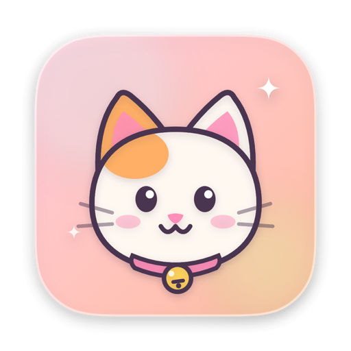
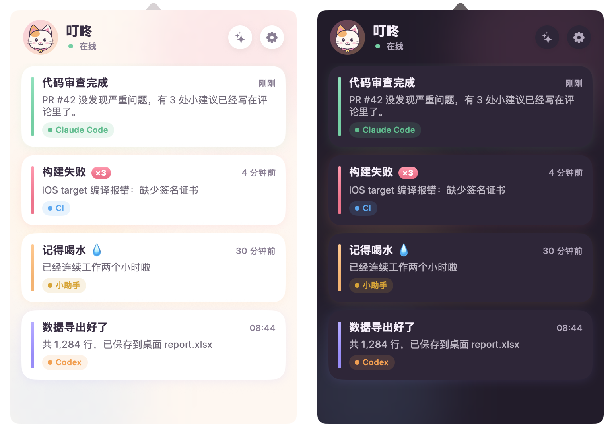
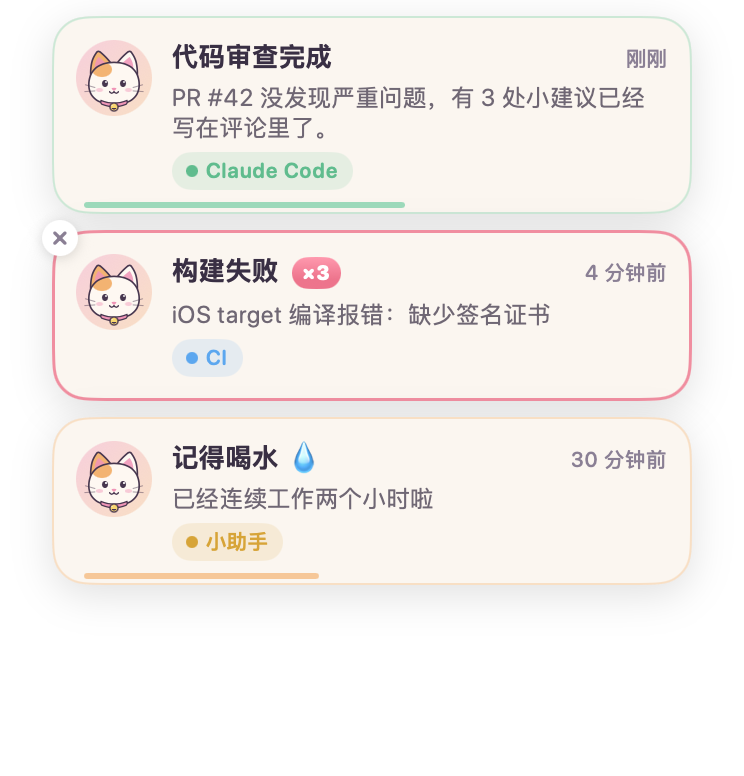
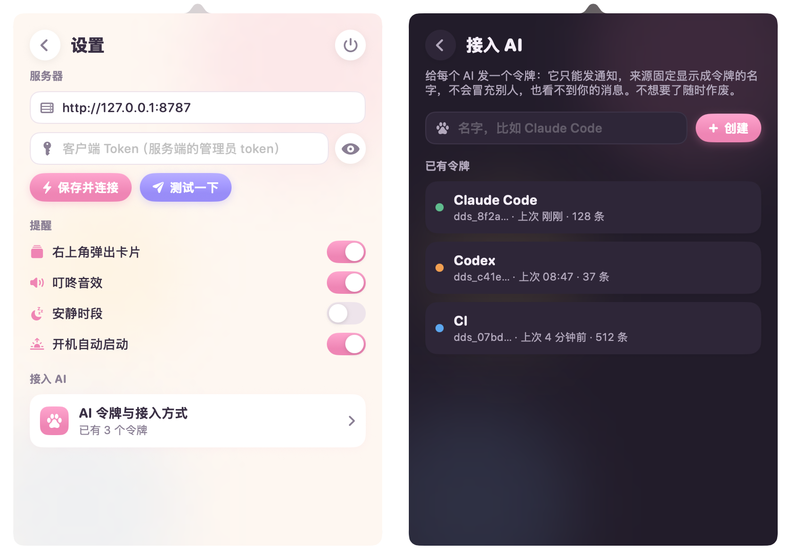

<p align="center">
  
</p>

<h1 align="center">叮咚 Dingdong</h1>

<p align="center">
  <b>让你的 AI 一行 HTTP 就能叫你。</b><br>
  一个可爱的 macOS 菜单栏通知器：Claude Code、Codex、CI、脚本……谁有事找你，小猫就摇铃。<br>
  <sub>A cute macOS menu bar notifier — let your AI agents ping you with one HTTP call.</sub>
</p>

<p align="center">
  <a href="https://github.com/xingqiux/dingdong/releases/latest"></a>
  <a href="https://github.com/xingqiux/dingdong/actions/workflows/ci.yml"></a>
  
  
</p>

<p align="center">
  
</p>

## 它做什么

```
AI / 脚本 ──POST /api/notify (令牌)──▶ 服务端 (Go) ──SSE──▶ 菜单栏客户端 (SwiftUI)
                    └─ 或者 MCP 工具 notify / Claude Code 钩子
```

每条通知只有四样东西：**标题 · 简短内容 · 来源 · 时间**。



- **来消息**：菜单栏的小猫歪头晃一晃，右上角弹出卡片，卡片上的小猫动耳朵、摇铃铛，“Pop”一声
- **重要的不会错过**：`error` 级别的卡片不自动消失；合盖、断网期间来的消息，重连后汇总提醒一次
- **不刷屏**：同样的通知 2 分钟内合并成一张，显示 ×N；每个发送方每分钟有上限
- **每个 AI 一个令牌**：只能发通知、看不到你的消息，来源固定为令牌名字，不能冒充；随时轮换或作废
- **安静时段 / 勿扰 1 小时**：不响不弹，菜单栏小猫闭眼睡觉；系统开了“减少动态效果”就不跳动画
- **深色模式**、开机自启、`dingdong://` 一键连接

<br clear="right">

## 安装客户端

**Homebrew**

```bash
brew tap xingqiux/tap && brew trust xingqiux/tap   # 新版 Homebrew 要先信任第三方 tap
brew install --cask dingdong
```

**或者**到 [Releases](https://github.com/xingqiux/dingdong/releases/latest) 下载 `Dingdong-vX.Y.Z.zip`，解压后拖进「应用程序」。

> [!NOTE]
> 叮咚没有经过 Apple 公证（需要付费开发者账号）。第一次打开被拦时，右键 → 打开，或者运行：
> `xattr -dr com.apple.quarantine /Applications/Dingdong.app`

**或者**自己编译（需要 Xcode 15+）：`./scripts/build-app.sh`，产物在 `dist/Dingdong.app`。

## 部署服务端

服务端是一个零依赖的 Go 程序，存储就是数据目录里的两个 JSON 文件。

**Docker（推荐）**

```bash
docker run -d --name dingdong -p 127.0.0.1:8787:8787 \
  -v dingdong-data:/data \
  -e DINGDONG_TOKEN="$(openssl rand -hex 24)" \
  ghcr.io/xingqiux/dingdong-server:latest
```

前面放一层 HTTPS 反代（Caddy、nginx、Cloudflare Tunnel 都行），客户端填 `https://你的域名`。SSE 需要反代别缓冲，服务端已经带了 `X-Accel-Buffering: no`。

**直接跑**：从 Releases 下载 `dingdong-server-<系统>-<架构>`，或者 `cd server && go build`：

```bash
./dingdong-server -addr 127.0.0.1:8787 -data ./data
```

第一次启动没设 `DINGDONG_TOKEN` 的话，会生成一个管理员 token 存进 `data/token`，并在日志里**只打印这一次**。设了 `DINGDONG_PUBLIC_URL` 还会打印一条 `dingdong://connect?...` 链接，在 Mac 上打开它就能一键配好客户端。

在本机常驻：`./scripts/install-server-launchd.sh`（登录后自动启动，崩了自动拉起）。

| 参数 | 默认 | 说明 |
|---|---|---|
| `-addr` / `DINGDONG_ADDR` | `127.0.0.1:8787` | 监听地址 |
| `-data` / `DINGDONG_DATA` | `./data` | 数据目录 |
| `DINGDONG_TOKEN` | 自动生成 | 管理员 token（客户端用） |
| `-keep` | `200` | 最多保留几条消息 |
| `-days` | `30` | 消息最多保留几天 |
| `-rate` / `-burst` | `30` / `10` | 每个发送方每分钟几条 / 最多连发几条 |
| `-dedup` | `2m` | 多久内的重复通知合并 |

## 让 AI 叫你

### 1. 给它一个令牌

客户端 → 设置 → **接入 AI**，输入名字（比如 `Claude Code`）点创建。令牌只显示一次，旁边有复制按钮，能直接复制下面几种接入方式。

<p align="center"></p>

也可以用 API（管理员 token）：

```bash
curl -X POST https://ding.example.com/api/tokens \
  -H "Authorization: Bearer <管理员 token>" -H "Content-Type: application/json" \
  -d '{"name":"Claude Code"}'
```

### 2. 选一种接法

**Claude Code 钩子**：任务做完、需要你批准时自动通知，不用 AI 记得调用。

```bash
curl -fsSL https://raw.githubusercontent.com/xingqiux/dingdong/main/integrations/claude-code/install.sh \
  | bash -s -- https://ding.example.com <令牌>
```

- 只有一轮跑超过 60 秒才通知“做完了”（`--min-seconds` 可调），短问答不打扰。标题是会话名，内容是用时和 Claude 最后一句话。
- 需要你批准权限、或在等你回复时，通知“需要你确认 / 在等你回复”。
- 装进 `${CLAUDE_CONFIG_DIR:-~/.claude}/settings.json`，原文件先备份，已有的 hooks 原样保留。卸载：`... | bash -s -- --uninstall`。

**MCP**：任何支持 MCP 的客户端都能用，工具名 `notify`。

```bash
claude mcp add --transport http --scope user dingdong https://ding.example.com/mcp \
  --header "Authorization: Bearer <令牌>"
```

**HTTP**：什么语言、什么工具都能调。

```bash
curl -X POST https://ding.example.com/api/notify \
  -H "Authorization: Bearer <令牌>" -H "Content-Type: application/json" \
  -d '{"title":"任务完成","body":"简短内容","level":"success"}'
```

| 字段 | 必填 | 说明 |
|---|---|---|
| `title` | ✓ | 标题，最多 80 字 |
| `body` |  | 简短内容，最多 500 字（也可以叫 `content`） |
| `level` |  | `info`（默认）/ `success` / `warning` / `error`。只决定颜色；`error` 的卡片不会自动消失 |
| `url` |  | 点击卡片时打开的链接 |
| `source` |  | 只有管理员 token 能指定；发送方令牌的来源固定是令牌名字 |

token 也可以放在 `X-Token` 请求头或 `?token=` 参数里；JSON、表单、GET 参数都能用。返回 `201`（新消息）、`200` + `"deduped":true`（合并到已有消息）、`429`（超过频率，带 `Retry-After`）。

终端小工具：`DINGDONG_URL=… DINGDONG_TOKEN=… ./scripts/ding "构建完成" "用时 42 秒" "" success`

**给 AI 的提示词片段**（没有 MCP 和钩子时）：

> 完成耗时任务、需要我确认、或遇到阻塞时，调用下面的命令通知我。标题一句话，内容不超过两句：
> `curl -s -X POST https://ding.example.com/api/notify -H "Authorization: Bearer <令牌>" -H "Content-Type: application/json" -d '{"title":"...","body":"...","level":"info|success|warning|error"}'`

## API

| 方法 | 路径 | 谁能用 | 作用 |
|---|---|---|---|
| POST / GET | `/api/notify` | 管理员、发送方 | 发通知 |
| POST | `/mcp` | 管理员、发送方 | MCP（Streamable HTTP，无状态），工具 `notify` |
| GET | `/api/stream` | 管理员 | SSE：先给 `snapshot`，之后推 `message` / `update` / `delete` / `clear` |
| GET | `/api/messages?limit=50` | 管理员 | 历史消息，新的在前 |
| DELETE | `/api/messages/{id}`、`/api/messages` | 管理员 | 删一条 / 清空 |
| GET / POST | `/api/tokens` | 管理员 | 列出 / 新建（同名即轮换）发送方令牌 |
| DELETE | `/api/tokens/{name}` | 管理员 | 作废令牌 |
| GET | `/healthz` | 所有人 | 健康检查和版本号 |

发送方令牌只存 SHA-256 哈希，列表接口只返回前缀。

## 客户端小技巧

- 菜单栏小猫：睁眼是平时，实心是有未读，闭眼是勿扰，× × 是断线
- 左键点小猫：消息面板；右键：勿扰 1 小时、测试通知、接入 AI、退出
- 卡片：悬停出现 × 删除；右键复制内容；有 `url` 时点一下就打开
- 右上角 ✨ 点两下清空全部
- 一键连接：`open "dingdong://connect?url=https://ding.example.com&token=<管理员 token>"`（会先弹窗确认）

## 连不上 / 连得慢？

- 客户端连接时错开发起最多 3 个连接，谁先通就用谁；12 秒都没通就整体重来，断线期间的消息重连后会汇总提醒，不会丢。
- 开着代理软件的 TUN / 增强模式时，系统流量可能绕到很慢的出口，表现为“连接中”要等十几秒。给你的叮咚域名单独加一条走直连或快线路的规则即可。
- 反代要关掉缓冲（SSE），Cloudflare Tunnel 不需要额外设置。

## 开发

```
server/                 Go 服务端（hub 存储广播 · auth 令牌和限流 · api 路由 · mcp）
client/                 SwiftUI + AppKit 菜单栏客户端（Swift Package，macOS 14+）
integrations/claude-code  Claude Code 钩子和安装脚本
scripts/                build-app.sh 打包 · render-icon.sh 生成图标 · ding 命令行 · install-server-launchd.sh
```

```bash
cd server && go test ./...                               # 服务端测试
./scripts/build-app.sh                                   # 打包客户端
dist/Dingdong.app/Contents/MacOS/Dingdong --demo --dark  # 演示模式：不联网，假数据
./scripts/render-icon.sh                                 # 猫咪图标是代码画的，改完重新生成
```

发版：推一个 `v*` 标签，GitHub Actions 会编出通用版 `.app`、各平台服务端二进制，并把多架构镜像推到 `ghcr.io/xingqiux/dingdong-server`。

## License

MIT
